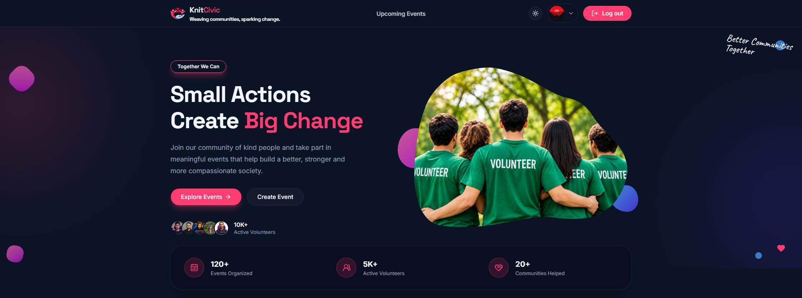
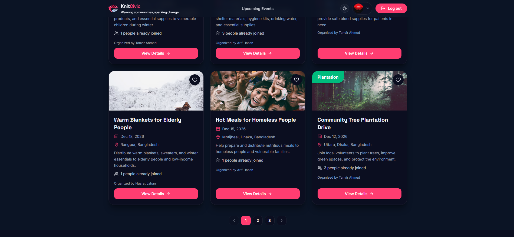
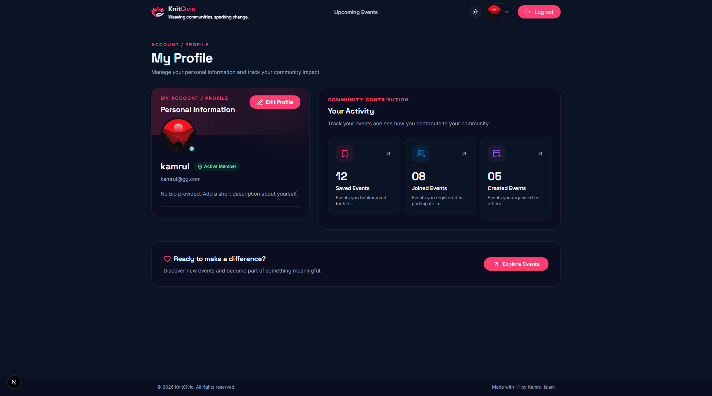

<div align="center">

# 🌐 KnitCivic

### Connect People. Create Events. Build Stronger Communities.

**KnitCivic** is a social event platform that brings people together through meaningful community activities. Discover local events, connect with like-minded people, participate in social initiatives, and make a positive impact on your community.

<br/>

[](https://knitcivic.vercel.app)
[](YOUR_FRONTEND_REPO)
[](YOUR_BACKEND_REPO)

<br/>


</div>

---

## ✨ About KnitCivic

KnitCivic is built to make community engagement easier and more accessible. Whether someone wants to organize a charity event, join a community gathering, or participate in meaningful social activities, KnitCivic provides a platform to make those connections happen.

Our goal is simple: **Bring people together and turn good ideas into real-world impact.**

## 🚀 Key Features

- **🔍 Discover Events** — Explore community events, browse activities, and find opportunities that match your interests.
- **📅 Create & Manage Events** — Organize events, publish event details, and manage your community activities.
- **🤝 Join Community Events** — Participate in events, connect with other members, and become an active part of your community.
- **❤️ Save Your Favorite Events** — Bookmark interesting events and easily access them whenever you want.
- **👤 Personalized User Dashboard** — Manage your profile, track joined events, view created events, and monitor your community contributions.

## 🛠️ Technology Stack

KnitCivic is developed using modern technologies to deliver a responsive, scalable, and secure web experience.

### Frontend

| Technology   | Purpose                                 |
| ------------ | --------------------------------------- |
| Next.js      | React framework and application routing |
| React        | Component-based UI development          |
| TypeScript   | Type-safe development                   |
| Tailwind CSS | Utility-first styling                   |
| shadcn/ui    | Reusable UI components                  |
| HeroUI       | Modern UI components and interactions   |
| Lucide React | Icon library                            |

### Backend

| Technology  | Purpose                                          |
| ----------- | ------------------------------------------------ |
| Node.js     | JavaScript runtime                               |
| Express.js  | REST API development                             |
| MongoDB     | NoSQL database                                   |
| Better Auth | Authentication and session management            |
| JWT         | Token-based API authentication and authorization |

## ⚙️ Getting Started

Follow these instructions to run KnitCivic locally.

### Prerequisites

Make sure you have installed:

- Node.js (v20 or later recommended)
- npm
- MongoDB database
- Git

### 1. Clone the Repository

```bash
git clone YOUR_GITHUB_REPOSITORY_URL
```

### 2. Set Up the Frontend

```bash
cd client
npm install
```

Create a `.env.local` file:

```env
NEXT_PUBLIC_API_URL=http://localhost:5000
BETTER_AUTH_URL=http://localhost:3000
```

Start the development server:

```bash
npm run dev
```

Frontend runs at: `http://localhost:3000`

### 3. Set Up the Backend

Open another terminal:

```bash
cd server
npm install
```

Create a `.env` file:

```env
PORT=5000
MONGODB_URI=your_mongodb_connection_string
JWT_SECRET=your_jwt_secret
```

Start the backend server:

```bash
npm run dev
```

Backend runs at: `http://localhost:5000`

**Note:** Configure your Better Auth server URL, trusted origins, and JWT settings according to your actual authentication implementation. Never expose private secrets in frontend environment variables.

## 🔐 Authentication & Security

KnitCivic uses Better Auth for authentication and JWT for secure communication between the frontend and backend.

- Secure user authentication.
- Session management.
- JWT-based API token verification.
- Protected API endpoints.
- Authenticated event management.

## 📸 Screenshots

<div align="center">

### Home Page



### Event Discovery



### User Dashboard



</div>

## 🗺️ Future Improvements

- Real-time notifications for event updates.
- Advanced event search and filtering.
- Community messaging and discussions.
- Event reviews and feedback.
- Improved event recommendations.

## 🤝 Contributing

Contributions, ideas, and suggestions are always welcome!

If you would like to contribute:

1. Fork the repository.
2. Create a new branch.
3. Make your changes.
4. Commit your changes.
5. Open a Pull Request.


## 👨‍💻 Developer

**Developed with ❤️ by Shahid Ahmed**

Building connections, encouraging participation, and creating meaningful community experiences.

---

<div align="center">

### ❤️ KnitCivic

**Together, We Make Communities Stronger.**

<sub>© 2026 KnitCivic. All Rights Reserved.</sub>

</div>
